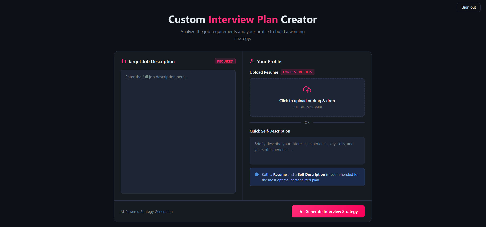
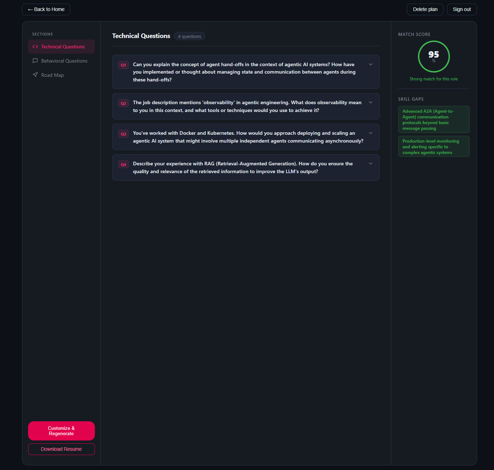

# Interview Helper

An AI-powered interview preparation tool. Upload your resume (PDF), describe yourself, and paste a job description — the app uses Google Gemini to generate a tailored **interview report** (match score, likely technical and behavioral questions with suggested answers, skill gaps, and a day-wise preparation plan) and can also generate a **job-tailored resume PDF**.





## Features

- **Tailored interview strategy** — upload your resume (drag & drop PDF), paste the job description, and get a plan built around that specific role
- **Match score & skill gaps** — see how well your profile fits the job, with missing skills ranked by severity
- **Technical & behavioral questions** — each with the interviewer's intention and a suggested way to answer
- **Day-wise preparation roadmap** — a focused, step-by-step plan to follow before the interview
- **Job-tailored resume PDF** — a clean, plain, ATS-friendly layout with section headings chosen to fit your background
- **Customize & Regenerate** — describe changes in plain words (structure, content or design) and regenerate; re-download the saved version instantly
- **Saved history** — every plan is stored per user, and can be reopened or deleted (with a confirmation dialog)
- **Secure accounts** — registration, login and logout using JWT cookies, with token blacklisting on logout and protected routes

## Tech Stack

| Layer    | Technology                                                                                   |
| -------- | -------------------------------------------------------------------------------------------- |
| Frontend | React 19, Vite, React Router 7, Axios, Sass                                                  |
| Backend  | Node.js, Express 5, Mongoose (MongoDB), Multer, pdf-parse                                    |
| AI       | Google Gemini via `@google/genai` (`gemini-2.5-flash-lite`, with `gemini-2.5-flash` fallback for resumes) |
| PDF      | Puppeteer (renders the resume template to PDF)                                               |
| Auth     | JSON Web Tokens, bcryptjs, cookie-parser                                                     |

## Architecture

```
┌──────────────┐  HTTP + cookies   ┌──────────────────┐        ┌───────────────┐
│   Frontend   │ ────────────────► │   Express API    │ ─────► │    MongoDB    │
│ React + Vite │ (localhost:5173)  │ (localhost:3000) │        │ users, reports│
└──────────────┘                   └───┬──────────┬───┘        │ blacklist     │
                                       │          │            └───────────────┘
                               prompts │          │ resume HTML
                                       ▼          ▼
                              ┌──────────────┐ ┌──────────────┐
                              │ Google Gemini│ │  Puppeteer   │
                              │ structured   │ │  HTML → PDF  │
                              │ JSON output  │ │              │
                              └──────────────┘ └──────────────┘
```

**Request flow for generating a report**

1. The user submits a resume PDF, a self description and a job description from the frontend.
2. The API authenticates the request (JWT cookie), extracts the resume text with `pdf-parse`, and sends everything to Gemini with a strict JSON response schema.
3. The structured report is saved to MongoDB and returned to the frontend, which renders it on the interview page.

**Request flow for the resume**

1. Gemini returns the resume as structured JSON (not HTML), which is saved with the report. Customization requests edit this saved JSON.
2. A fixed template turns the JSON into a plain, professional A4 layout, so the design stays consistent.
3. Puppeteer renders it to PDF and the browser downloads it. Re-downloading re-renders the saved resume without calling Gemini.

### API Endpoints

| Method | Endpoint                                    | Auth | Description                                   |
| ------ | ------------------------------------------- | ---- | --------------------------------------------- |
| POST   | `/api/auth/register`                        | No   | Register a new user                           |
| POST   | `/api/auth/login`                           | No   | Log in with email and password                |
| GET    | `/api/auth/logout`                          | No   | Clear the auth cookie and blacklist the token |
| GET    | `/api/auth/get-me`                          | Yes  | Get the current user                          |
| POST   | `/api/interview/`                           | Yes  | Generate an interview report (multipart form) |
| GET    | `/api/interview/`                           | Yes  | List all of the user's reports                |
| GET    | `/api/interview/report/:interviewId`        | Yes  | Get a single report                           |
| POST   | `/api/interview/resume/pdf/:interviewReportId` | Yes | Generate / customize / re-download the resume PDF (optional `customization` in body) |
| DELETE | `/api/interview/report/:interviewId`        | Yes  | Delete a saved report                         |

## Project Structure

```
interview-helper/
├── assets/                     # README screenshots
├── Backend/
│   ├── server.js               # Entry point: loads env, connects DB, starts server (port 3000)
│   └── src/
│       ├── app.js              # Express app, CORS, middleware and route mounting
│       ├── config/             # Database connection
│       ├── controllers/        # Request handlers (auth, interview)
│       ├── middlewares/        # JWT auth, file upload (Multer, 3 MB limit)
│       ├── models/             # Mongoose models (user, interviewReport, blacklist)
│       ├── routes/             # Route definitions (auth, interview)
│       └── services/           # Gemini + Puppeteer logic (ai.service.js), resume layout (resumeTemplate.js)
└── Frontend/
    ├── index.html
    ├── vite.config.js
    └── src/
        ├── main.jsx, App.jsx, app.routes.jsx
        ├── features/
        │   ├── auth/           # Login/Register pages, auth context, hooks, API calls
        │   └── interview/      # Home/Interview pages, modals & loading screen, interview context, hooks, API calls
        └── style/              # Shared Sass styles (buttons, modal, spinner)
```

## Prerequisites

- [Node.js](https://nodejs.org/) v22.12 or newer (and npm)
- A MongoDB database — a free [MongoDB Atlas](https://www.mongodb.com/atlas) cluster or a local MongoDB instance
- A [Google Gemini API key](https://aistudio.google.com/app/apikey)

## Getting Started

### 1. Clone the repository

```bash
git clone <your-repo-url>
cd interview-helper
```

### 2. Set up the backend

```bash
cd Backend
npm install
```

Create a `.env` file in the `Backend/` directory:

```env
MONGO_URI=your_mongodb_connection_string
JWT_SECRET=a_long_random_secret_string
GOOGLE_GENAI_API_KEY=your_google_gemini_api_key
```

**Using a local MongoDB instead of Atlas (quick start):** if you have [MongoDB Community Server](https://www.mongodb.com/try/download/community) installed and running, set

```env
MONGO_URI=mongodb://127.0.0.1:27017/interview-helper
```

The database and collections are created automatically on first use. No Atlas account, network access or IP allow-listing is required. (On Windows, MongoDB runs as a service named `MongoDB` by default; check it with `Get-Service MongoDB`.)

Start the API (runs on <http://localhost:3000>):

```bash
npm run dev
```

> `npm run dev` uses [nodemon](https://nodemon.io/), which isn't listed in `Backend/package.json`. Install it globally with `npm install -g nodemon`, or just run `node server.js` instead.

### 3. Set up the frontend

In a second terminal:

```bash
cd Frontend
npm install
npm run dev
```

Open <http://localhost:5173> in your browser, register an account, and generate your first interview report.

> The frontend expects the API at `http://localhost:3000` and the backend allows CORS from `http://localhost:5173`. If you change either port or host, update `Backend/src/app.js` and the `baseURL` in `Frontend/src/features/*/services/*.api.js`.
